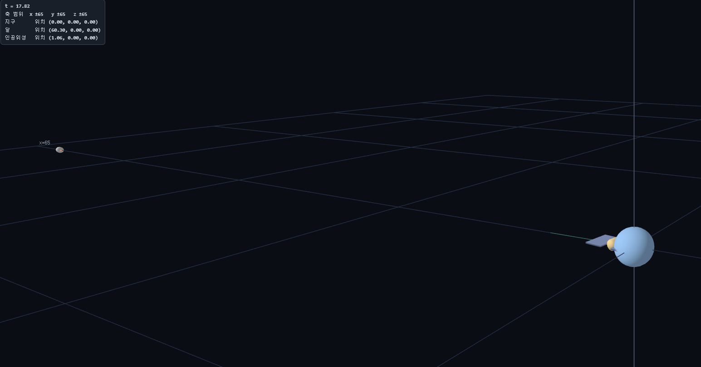
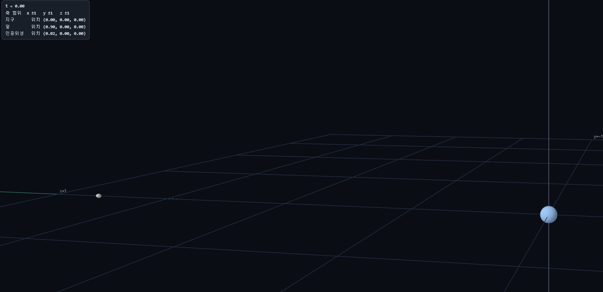
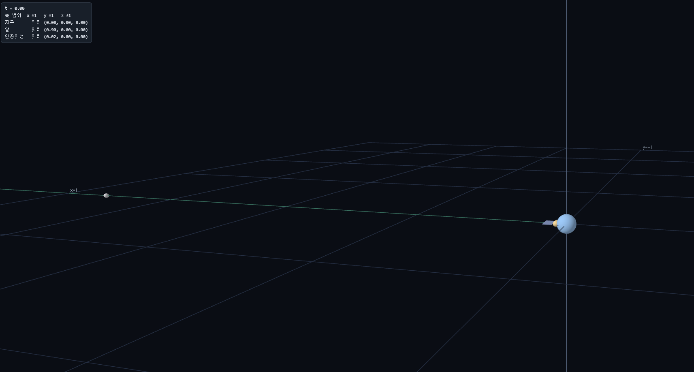

# 2주차 과제 - 변환과 행렬

## 1. Task 1: 실제 비율로 배치한 지구와 인공위성
* **변환 설정값 및 설명**:
  - 지구 반지름을 1로 두는 무차원 단위계를 선택했습니다. 지구, 달, 인공위성 간의 거리를 미터나 킬로미터 단위로 그대로 입력하면 수치가 너무 커져 연산이 힘들며, 연산 오차와 반올림으로 인해 작은 위성 크기나 고도가 소실되는 문제를 방지하기 위함입니다.
  - 정점에 회전이 먼저 적용된 후 이동이 일어나야 공전 궤도상에서 로컬 축화살표 방향이 지구 중심을 올바르게 바라보게 되므로, 원점 제자리에서 수행하는 회전 변환 단계 덕분에 달과 위성이 지구를 향하게 됩니다.
* **공유 링크**: (task1.html)
* **결과 화면**:
  

---

## 2. Task 2: 축 범위 변경과 배율 행렬의 배치
* **변환 설정값 및 설명**:
  - 축 범위를 1로 변경한 후, 원점에서 가장 먼 지점(지구-달 거리 + 달 반지름)을 기준으로 역수를 취해 0.015(1/60.57에서 여유를 둔 값)로 정했습니다.
  - **맨 앞에 넣은 이유**: 행렬 곱은 오른쪽에서 먼저 적용되므로, 배율 행렬을 맨 앞에(가장 왼쪽에) 두면 이미 계산된 물체의 위치와 이동·회전까지 포함한 전체 장이 통째로 축소되기 때문입니다.
  - **맨 뒤에 넣으면**: 정점 좌표에 스케일이 먼저 국소적으로 적용되어 위치는 원래대로 큰 채 크기만 줄어들거나 궤적이 의도와 달라져 달이 여전히 화면 밖으로 나가게 됩니다.
  - **세 물체에 같은 배율을 쓴 이유**: 지구, 달, 인공위성 간의 실제 상대적인 거리와 크기 비율을 그대로 유지한 채 화면에 담기 위해서입니다.
  - **화면에서의 모습**: 전체 시스템이 균일하게 축소되어 지구는 화면 안에 알맞은 크기로 들어오지만, 원래 크기 차이가 매우 큰 인공위성은 상대적으로 지나치게 작아져서 거의 안 보이는 수준에 이르게 됩니다.
* **공유 링크**: (task2.html)
* **결과 화면**:
  

---

## 3. Task 3: 비율 유지의 한계와 시각적 개선
* **질문 답변**:
  1. **실제 비율이 정보를 전달하기에 적합한가?** 
     - 적합하지 않다고 생각합니다. 실제 천체 간의 거리와 크기 비율을 그대로 적용하면 지름이 압도적으로 작은 인공위성은 거의 보이지 않는 수준에 이르고 달과의 거리가 멀어 전체 시스템 구조를 시각적으로 인지하기 어렵기 때문입니다.
  2. **제안하는 방법 (인공위성 크기 과장법):** 
     - 지구와 달의 공전 궤도 및 상대 거리는 실제 비율(s = 0.015)을 유지한 채, 인공위성의 스케일 행렬 사슬 맨 뒤에 곱해주는 고유 배율 값을 의도적으로 크게 키워 시각적으로 눈에 띄게 배치합니다.
  3. **장점과 잃는 것:** 
     - **장점:** 지구와 달의 전체적인 공전 궤도시스템을 한눈에 파악할 수 있으면서도, 화면 속에서 인공위성의 존재와 궤도 움직임을 명확하게 식별할 수 있습니다.
     - **잃는 것:** 인공위성의 실제 물리적 크기와 지구 간의 정확한 상대적 크기 비례 관계는 포기해야 합니다.
* **공유 링크**: (task3.html)
* **결과 화면**:
  